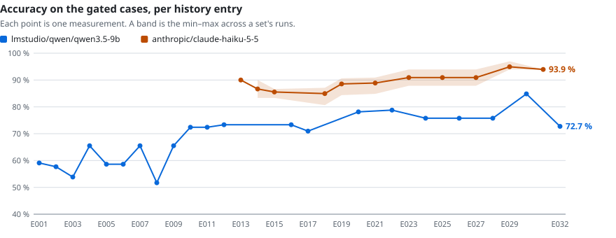
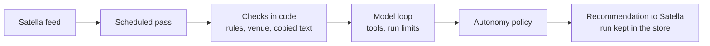
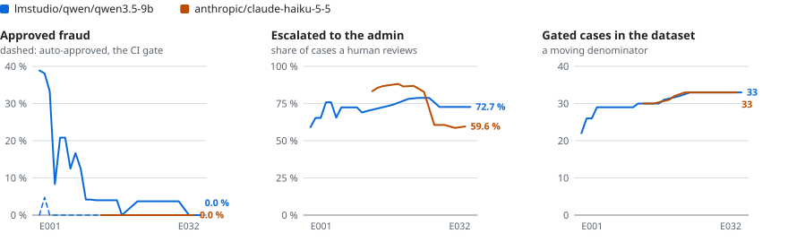

# anti-fraud-agent

An AI agent that reviews every new event and organizer on Satella, a Spanish ticketing platform,
and leaves a reasoned recommendation for a human admin: **approve**, **reject** or **request
info**. It works on Satella's staging environment, with synthetic data, and never changes an
event itself: the admin always has the last word.

The interesting part isn't that a model reads an event. It's how much the system lets the model
decide on its own, and how I know that trust is deserved.

**Status:** deployed. A scheduled job reviews staging's feed every 10 minutes with Claude Haiku
5.5, within a daily budget. I'm still working on it; what it doesn't do well yet is
[below](#what-it-doesnt-do-well-yet).

<picture>
  <source media="(prefers-color-scheme: dark)" srcset="evals/charts/accuracy-dark.svg">
  
</picture>

## The problem

A ticketing platform that lets anyone publish an event attracts a familiar set of frauds: a bar
of 140 people selling 2,000 tickets, a description that asks buyers to pay by Bizum and "skip the
fees", a clone of another promoter's concert, a terms page that refuses refunds even if the
event is cancelled, a prompt injection hidden in the description. Each of these costs buyers money
and the platform its reputation.

An admin can catch them, but reviewing every event by hand doesn't scale. A language model reads
an event well, but it can be fooled, it can be confidently wrong, and it reads organizer text that
may be written to manipulate it. So the agent is built around one rule:

> **The model proposes. Code decides how far to trust it.**

## How a review works

1. **The pass** reads the subjects that changed since the last pass, reviews each once, and
   reserves each review's worst-case cost against the day's budget
   ([ADR 0017](docs/adr/0017-scheduled-pass-reviews-feed-within-day-budget.md)).
2. **Checks in code run first.** Rules that anyone can verify (postal code against province,
   overlapping sessions, payment off the platform, a wrong tax id), the venue checked against
   OpenStreetMap and Wikidata, and a web search for a copied description
   ([ADR 0015](docs/adr/0015-external-evidence-venue-checks-and-sourced-search.md)). Their
   findings are authoritative: the model can't overrule them.
3. **The model** reads the event and those findings, marked as untrusted data, calls tools (the
   organizer's history, similar events, a price benchmark, web search) within hard limits on
   calls, tokens and searches, and proposes a decision with its findings.
4. **The policy** decides whether that proposal resolves on its own or goes to the admin
   ([ADR 0012](docs/adr/0012-autonomy-rests-on-deterministic-checks.md)).
5. **Satella** receives the recommendation, and the agent's store keeps the whole run: findings,
   tool trace, tokens and cost.

## Graded autonomy

Every review has two independent parts. The **decision** is what the model proposes. The
**autonomy** is computed by a pure function from the evidence, never from the model's own
confidence: `auto_resolved` means the evidence is strong enough to stand on its own, `escalated`
means a human should look.

| Decision         | Resolves on its own when…                                                                       | Example                                                             | Escalated when…                                                                |
| ---------------- | ----------------------------------------------------------------------------------------------- | ------------------------------------------------------------------- | ------------------------------------------------------------------------------ |
| **approve**      | no check flagged anything, the model raised at most one minor warning, and the venue checks out | A 400-person room selling 350 tickets, organizer with a website     | anything is flagged, the capacity can't be bounded, or it's an organizer       |
| **reject**       | a hard signal backs it: a rule finding, or a source a tool actually retrieved during the review | "Pay by Bizum to 600 000 000"; a clone of another organizer's event | it rests on suspicion or a source the model wrote itself, or it's an organizer |
| **request info** | every problem found is a rule anyone can verify, so the request is mechanical                   | A Madrid postal code with the province Sevilla                      | any problem needs judgement: a 45 % service fee, a prompt injection            |

Only one of the six outcomes skips the admin in Satella: **approve + auto-resolved**. That is the
outcome the evals guard hardest: CI fails if any fraud case ends there. The other autonomies are
still recorded, so the admin's decisions can later show whether more could be automated.

The review's confidence follows the same idea. It is the tier of the evidence that resolved it
(a rule, a verified capacity, an exposure cap), not a number the model chose
([ADR 0019](docs/adr/0019-confidence-is-derived-from-the-evidence-tier.md)).

## How I know it works

A dataset of eval cases covers the fraud patterns above and legitimate events that should pass.
The organizers, promoters and artists in the fraud cases are invented. Each case says which
decision and autonomy are right.

- **Record once, replay in CI.** Running the agent against a real model records every model and
  tool response. CI replays them through the real agent in seconds, with no model, no network and
  no cost. Each recording is valid only for the exact request it answered, so a change to the
  prompt or a check marks the affected recordings stale instead of reusing old answers
  ([ADR 0013](docs/adr/0013-evals-replay-recorded-model-responses.md)).
- **The hosted model runs each case three times.** It isn't deterministic, so a metric is a mean
  with its range: two measurements differ only where their ranges don't overlap.
- **A fooled model tests the code, not the model.** CI also runs every gated fraud case with a
  model that approves everything at 0.95 confidence, once with the web answering and once with it
  down. Every case the code claims to decide must still reach the admin; the cases that rest on the
  model's judgement are listed apart, so it is clear which guarantees are the code's
  ([ADR 0013](docs/adr/0013-evals-replay-recorded-model-responses.md), amendment of #82).
- **Every change that moves a metric leaves a line and a reason.** A machine-written history holds
  the numbers; an experiment log holds the hypothesis, the result and the decision. CI fails until
  both match the replay ([ADR 0014](docs/adr/0014-eval-metrics-history-and-experiment-log.md)).

The latest measurement of each model, regenerated from the history by every replay:

<!-- eval-summary:start · generated by `pnpm eval:replay` from evals/history.jsonl: don't edit -->
<!-- prettier-ignore-start -->
| Model | Latest entry | Runs per case | Gated cases | Accuracy | Approved fraud | Auto-approved fraud | Escalated |
| --- | --- | --- | --- | --- | --- | --- | --- |
| `lmstudio/qwen/qwen3.5-9b` | E032 · 2026-11-07 | 1 | 33 | 72.7 % | 0.0 % | 0.0 % | 72.7 % |
| `anthropic/claude-haiku-5-5` | E031 · 2026-11-07 | 3 | 33 | 93.9 % (93.9–93.9) | 0.0 % (0.0–0.0) | 0.0 % (0.0–0.0) | 59.6 % |
<!-- prettier-ignore-end -->
<!-- eval-summary:end -->

**Gated** cases are the ones that can fail CI; a case the agent can't settle yet (an image it
doesn't read) is measured but left out. **Approved fraud** counts fraud cases whose final decision
was approve, whether or not the policy escalated them. **Auto-approved fraud** is the one that
would reach buyers.

<picture>
  <source media="(prefers-color-scheme: dark)" srcset="evals/charts/rates-dark.svg">
  
</picture>

The full per-case report is [`evals/report.md`](evals/report.md), and the story behind every
point is in [`docs/experiments.md`](docs/experiments.md).

## What it doesn't do well yet

- **It doesn't read images.** A poster carrying another ticketing site's logo or QR code goes
  unnoticed; that case stays outside the gate.
- **Some rules read text too literally.** The alcohol-to-minors rule splits clauses on
  punctuation, so a comma can hide an offer from the rule and leave it to the model.
- **It escalates more than it needs to.** Most limitations cost the admin time rather than let
  fraud through: an event in a square keeps the cap meant for unknown venues, for instance.
- **Public map services aren't built for production volume.** The agent throttles itself and
  reviews a small batch per pass.

None of them lets gated fraud skip the admin. The full list, with the evidence and the fix for
each, is in [`docs/known-limitations.md`](docs/known-limitations.md).

## Decisions worth arguing about

- [`docs/design-highlights.md`](docs/design-highlights.md): the decisions, each with its reason and
  its evidence. Start here.
- [`docs/adr/`](docs/adr/): every architecture decision, with the alternatives rejected.
- [`docs/architecture.md`](docs/architecture.md): the code layout and the deployment.
- [`docs/agent-design-brief.md`](docs/agent-design-brief.md): the original specification, in
  Spanish.

## Running it

TypeScript on Node, Vitest, Zod at every boundary. The evals replay with no keys and no cost;
[`docs/development.md`](docs/development.md) has the commands, the providers and how to record.

## Data attribution

Venue data © [OpenStreetMap](https://www.openstreetmap.org/copyright) contributors, available
under the Open Database License (ODbL 1.0), through Nominatim. Recorded venue lookups under
`evals/tool-responses/` carry that data. Wikidata content is CC0.

## License

[MIT](LICENSE).
