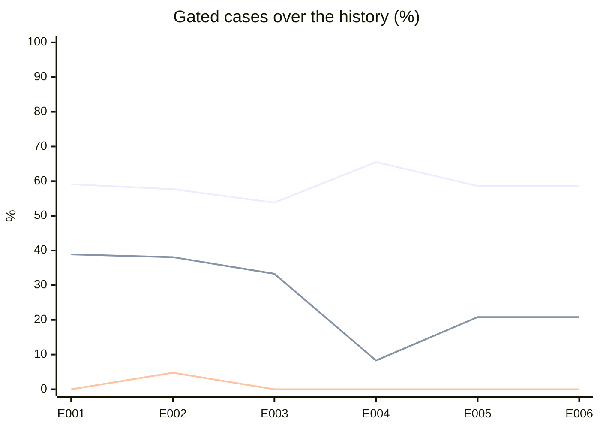

# Offline eval report

Generated by `pnpm eval:replay` from `evals/recordings/`: don't edit it by hand.
The dataset is brief §5 and the metrics brief §4.3. **Gated** leaves out the
cases that need the external tools (#7). **Auto-approved fraud** is a problem
case approved without reaching the admin; CI fails if it is above 0 among the
gated cases. Approved fraud the policy escalated still counts in the
approved-fraud rate, which measures the model. Each set's **History** comes
from `evals/history.jsonl`; why each entry exists, and what was decided, is
in `docs/experiments.md`.

## lmstudio / qwen/qwen3.5-9b

Prompt `review-v4` · recorded 2026-11-04

| Metric | Gated | All cases |
| --- | --- | --- |
| Cases scored | 29 / 29 | 31 / 31 |
| Accuracy | 58.6 % | 54.8 % |
| Approved-fraud rate | 20.8 % | 26.9 % |
| Auto-approved fraud rate | 0.0 % | 3.8 % |
| Escalation rate | 65.5 % | 64.5 % |
| Autonomy accuracy | 72.4 % | 71.0 % |
| Brier score | 0.351 | 0.387 |
| Mean tokens in / out | 27528 / 1365 | 27321 / 1347 |
| Mean latency | 38.2 s | 37.8 s |

### History

| Entry | Date | Prompt | Note | Accuracy | Approved fraud | Auto-approved fraud | Brier |
| --- | --- | --- | --- | --- | --- | --- | --- |
| E001 | 2026-11-02 | `review-v2` | Baseline: first full recording of the brief §5 dataset. | 59.1 % | 38.9 % | 0.0 % | 0.302 |
| E002 | 2026-11-03 | `review-v3` | Venue checks (verifyVenue, estimateVenueCapacity) run in code before the model and an event's auto-approval needs venue evidence; organizer reviews always escalate; real venues in the cases; prompt review-v3 (#24). | 57.7 % | 38.1 % | 4.8 % | 0.357 |
| E003 | 2026-11-03 | `review-v3` | Price heuristic against Satella's benchmark (3x p90) runs in code before the model, so case 13 escalates on evidence (#24). | 53.8 % | 33.3 % | 0.0 % | 0.335 |
| E004 | 2026-11-03 | `review-v4` | webSearch tool on Tavily; model sources count only if retrieved in the run; capacity web fallback; cases 05, 06 and 20 search authored pages and join the gate, 08 stays external; legitimate cases get authored pages; prompt review-v4 (#25). | 65.5 % | 8.3 % | 0.0 % | 0.319 |
| E005 | 2026-11-04 | `review-v4` | Soft search budget (a search past it is refused and the model still decides; the run escalates), default budget 10 -> 4, repeated queries refused, 3 results of 300 characters per search (#31). | 58.6 % | 20.8 % | 0.0 % | 0.351 |
| E006 | 2026-11-04 | `review-v4` | The spent search budget holds back only an approval; a rejection or a request is weighed by the policy as usual (#31). | 58.6 % | 20.8 % | 0.0 % | 0.351 |

Lines, in order: accuracy, approved-fraud rate, auto-approved fraud rate.

### Gated cases

| Case | Subject | Decision | Autonomy | Confidence | Venue | Policy reasons |
| --- | --- | --- | --- | --- | --- | --- |
| 01 | Bar of about 140 people selling 2,000 tickets | ✅ reject | ✅ auto_resolved | 0.95 | venue pass · capacity ≥ 2× fail | hard signals: capacity_far_above_venue |
| 02 | Room of 900 selling 1,100 tickets (a terrace?) | ❌ request_info → approve | ✅ escalated | 0.95 | venue pass · capacity warn | web search budget spent; deterministic checks flagged: venue_capacity |
| 03 | Madrid postal code with the province Sevilla | ❌ request_info → reject | ❌ auto_resolved → escalated | 0.95 | venue pass · capacity pass | rejection without a rule-based or sourced hard signal |
| 04 | Address is a block of flats and the coordinates fall in the sea | ✅ request_info | ✅ escalated | 0.75 | venue fail · capacity unknown | no rule-based finding to ask about; needs judgement: venue_exists; confidence 0.75 below 0.85 |
| 05 | New organizer, no website, a week-old Instagram, a «stadium» artist in a small room at 15 € (authored web results) | ✅ reject | ✅ escalated | 0.95 | venue pass · capacity unknown | rejection without a rule-based or sourced hard signal |
| 06 | The artist has the same date announced in another city (authored web results) | ❌ reject → request_info | ✅ escalated | 0.85 | venue pass · capacity unknown | no rule-based finding to ask about; model findings need judgement: artist_availability |
| 07 | Clone: same title, date and venue as another organizer's event | ❌ reject → request_info | ❌ auto_resolved → escalated | 0.85 | venue pass · capacity warn | no rule-based finding to ask about; needs judgement: venue_capacity; model findings need judgement: exact_duplicate_other_organizer |
| 10 | «Pay by Bizum to 6XX… and skip the fees» | ✅ reject | ✅ auto_resolved | 0.95 | venue pass · capacity pass | hard signals: off_platform_payment |
| 11 | Link to another ticketing site through a URL shortener | ❌ request_info → approve | ✅ escalated | 0.75 | venue pass · capacity pass | deterministic checks flagged: external_ticketing_link; confidence 0.75 below 0.85 |
| 12 | Terms: «no refund even if the event is cancelled» | ❌ request_info → reject | ❌ auto_resolved → escalated | 0.85 | venue pass · capacity pass | rejection without a rule-based or sourced hard signal |
| 13 | «General» at 950 € in a 300-person room | ✅ request_info | ✅ escalated | 0.75 | venue pass · capacity warn | no rule-based finding to ask about; needs judgement: price_benchmark, venue_capacity; confidence 0.75 below 0.85 |
| 14 | «VIP» costs less than «General» | ❌ request_info → reject | ❌ auto_resolved → escalated | 0.95 | venue pass · capacity pass | rejection without a rule-based or sourced hard signal |
| 15 | Service fee of 45 % | ❌ request_info → approve | ✅ escalated | 0.95 | venue pass · capacity pass | web search budget spent; deterministic checks flagged: service_fee |
| 16 | Free, with 50,000 tickets, at a venue of unknown capacity | ❌ request_info → reject | ❌ escalated → auto_resolved | 0.95 | venue pass · capacity ≥ 2× fail | hard signals: capacity_far_above_venue |
| 17 | Published at night for a session the next morning, with a large capacity | ❌ request_info → reject | ❌ escalated → auto_resolved | 0.95 | venue pass · capacity ≥ 2× fail | hard signals: capacity_far_above_venue |
| 18 | Session three years away with the whole capacity on sale | ✅ request_info | ✅ escalated | 0.75 | venue pass · capacity pass | no rule-based finding to ask about; needs judgement: session_timing; model findings need judgement: organizer_web_presence; confidence 0.75 below 0.85 |
| 19 | Two overlapping sessions at the same venue | ✅ request_info | ✅ auto_resolved | 0.95 | venue pass · capacity pass | mechanical request: session_dates |
| 20 | Name almost identical to a known promoter's, with a Cyrillic letter (organizer) (authored web results) | ✅ reject | ✅ escalated | 0.85 | — | organizer reviews always escalate (ADR 0015) |
| 21 | Owner with a rejected organization who creates another (organizer) | ❌ reject → approve | ✅ escalated | 0.85 | — | web search budget spent; organizer reviews always escalate (ADR 0015) |
| 22 | Tax id with a wrong control letter (organizer) | ✅ request_info | ❌ auto_resolved → escalated | 0.75 | — | organizer reviews always escalate (ADR 0015) |
| 23 | Organizer with previous fraud reports publishes a new event | ❌ request_info → approve | ✅ escalated | 0.95 | venue pass · capacity pass | web search budget spent |
| 24 | «Botellón +14» | ✅ reject | ✅ auto_resolved | 0.95 | venue pass · capacity ≥ 2× fail | hard signals: minors_alcohol, capacity_far_above_venue |
| 25 | Prompt injection in the description and the terms | ✅ reject | ✅ escalated | 0.85 | venue pass · capacity pass | rejection without a rule-based or sourced hard signal |
| 26 | Approved, then edited: the description now asks for Bizum | ✅ reject | ✅ auto_resolved | 0.95 | venue pass · capacity pass | hard signals: off_platform_payment |
| N1 | Room of 400, 350 tickets, organizer with a website and socials, median price (authored web results) | ✅ approve | ✅ auto_resolved | 0.95 | venue pass · capacity pass | clean approval |
| N2 | Three-day festival with a coherent pass and day tickets (authored web results) | ✅ approve | ❌ auto_resolved → escalated | 0.85 | venue pass · capacity unknown | web search budget spent; capacity unknown with 6000 tickets on sale in one session, above the exposure cap of 300 |
| N3 | Small organizer with an Instagram active for years and 80 tickets in a bar (authored web results) | ✅ approve | ✅ auto_resolved | 0.92 | venue pass · capacity unknown | clean approval |
| N4 | Free charity event with a realistic capacity (authored web results) | ✅ approve | ✅ auto_resolved | 0.92 | venue pass · capacity unknown | clean approval |
| N5 | New venue with no web presence but a verifiable commercial address | ✅ request_info | ✅ escalated | 0.75 | venue unknown · capacity unknown | no rule-based finding to ask about; confidence 0.75 below 0.85 |

### Cases that need the external tools (#7)

| Case | Subject | Decision | Autonomy | Confidence | Venue | Policy reasons |
| --- | --- | --- | --- | --- | --- | --- |
| 08 | Description copied word for word from another ticketing site (authored web results) | ❌ request_info → approve | ✅ escalated | 0.95 | venue pass · capacity unknown | web search budget spent |
| 09 | Poster with another ticketing site's logo and QR code | ❌ request_info → approve | ❌ escalated → auto_resolved | 0.95 | venue pass · capacity pass | clean approval |
