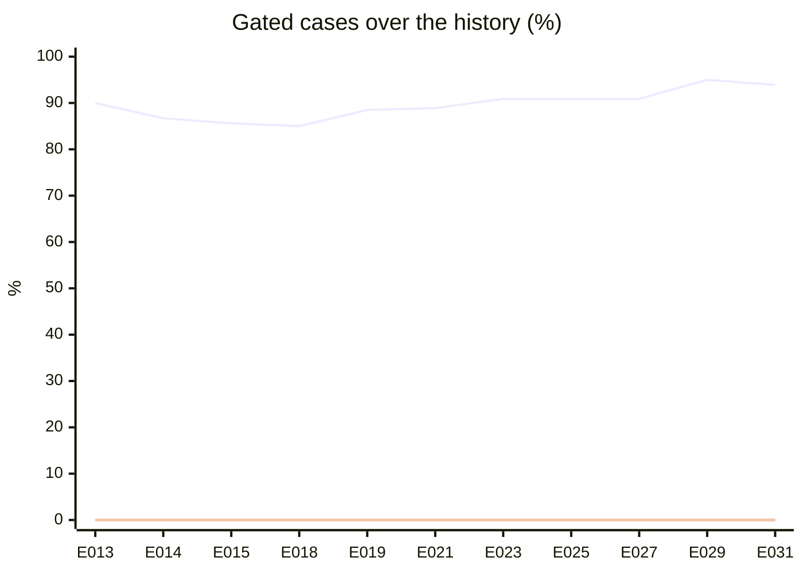
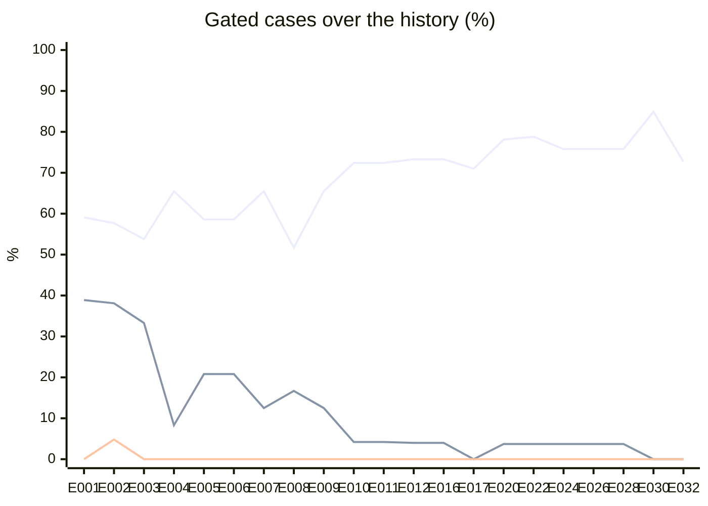

# Offline eval report

Generated by `pnpm eval:replay` from `evals/recordings/`: don't edit it by hand.
The dataset is brief §5 and the metrics brief §4.3. **Gated** leaves out the
cases that need the external tools (#7). **Auto-approved fraud** is a problem
case approved without reaching the admin; CI fails if it is above 0 among the
gated cases. Approved fraud the policy escalated still counts in the
approved-fraud rate, which measures the model. Each set's **History** comes
from `evals/history.jsonl`; why each entry exists, and what was decided, is
in `docs/experiments.md`.

A set recorded several times per case (#42) shows each metric's mean over
the runs, with the min–max of the four an experiment is decided on, and how
many runs agree on each case (`reject 2/3`). A case is right only when most
of its runs are, so a tie is wrong, and CI fails on a fraud case any run
auto-approved. An entry's **Runs** tells a mean from a single run: two
entries differ only where their ranges don't overlap.

## anthropic / claude-haiku-5-5

Prompt `review-v6` · recorded 2026-11-07 · 3 runs per case: means, with the min–max across runs

Live web searches: 0 failed of 184 attempted.

| Metric | Gated | All cases |
| --- | --- | --- |
| Cases scored | 33 / 33 | 34 / 34 |
| Accuracy | 93.9 % (93.9–93.9) | 94.1 % (94.1–94.1) |
| Approved-fraud rate | 0.0 % (0.0–0.0) | 0.0 % (0.0–0.0) |
| Auto-approved fraud rate | 0.0 % (0.0–0.0) | 0.0 % (0.0–0.0) |
| Escalation rate | 59.6 % | 60.8 % |
| Autonomy accuracy | 94.9 % (93.9–97.0) | 95.1 % (94.1–97.1) |
| Brier score | 0.137 | 0.138 |
| Mean tokens in / out | 14938 / 2546 | 15036 / 2542 |
| Mean latency | 11.7 s | 11.6 s |
| Mean cost per review | $0.0022 | $0.0022 |

### History

| Entry | Date | Prompt | Runs | Note | Accuracy | Approved fraud | Auto-approved fraud | Brier |
| --- | --- | --- | --- | --- | --- | --- | --- | --- |
| E013 | 2026-11-04 | `review-v5` | 1 | First Claude Haiku 5.5 set (anthropic adapter, effort medium) on the E012 prompt and cases | 90.0 % | 0.0 % | 0.0 % | 0.130 |
| E014 | 2026-11-04 | `review-v5` | 3 | Claude Haiku 5.5 recorded three times per case (runs 2 and 3 added to E013's run 1): metrics are means with their min-max (#42) | 86.7 % (83.3–90.0) | 0.0 % (0.0–0.0) | 0.0 % (0.0–0.0) | 0.144 |
| E015 | 2026-11-05 | `review-v5` | 3 | a capacity read from the web only holds back: unknown within it, warn above it (#57) | 85.6 % (83.3–86.7) | 0.0 % (0.0–0.0) | 0.0 % (0.0–0.0) | 0.152 |
| E018 | 2026-11-06 | `review-v5` | 3 | an active discount above 50 % with no usage limit warns (#73) | 85.0 % (80.7–87.1) | 0.0 % (0.0–0.0) | 0.0 % (0.0–0.0) | 0.166 |
| E019 | 2026-11-06 | `review-v5` | 3 | a session already held at review time warns while it still sells, or when every session is past (#72) | 88.5 % (84.4–90.6) | 0.0 % (0.0–0.0) | 0.0 % (0.0–0.0) | 0.155 |
| E021 | 2026-11-06 | `review-v5` | 3 | a venue without coordinates is looked up by name and town (#74) | 88.9 % (84.9–90.9) | 0.0 % (0.0–0.0) | 0.0 % (0.0–0.0) | 0.151 |
| E023 | 2026-11-06 | `review-v6` | 3 | the prompt rejects only on direct evidence and lists only what it found (review-v6, #76) | 90.9 % (87.9–93.9) | 0.0 % (0.0–0.0) | 0.0 % (0.0–0.0) | 0.152 |
| E025 | 2026-11-06 | `review-v6` | 3 | a review's confidence comes from its evidence tier, not the model's number (ADR 0019, #77) | 90.9 % (87.9–93.9) | 0.0 % (0.0–0.0) | 0.0 % (0.0–0.0) | 0.124 |
| E027 | 2026-11-06 | `review-v6` | 3 | Brier reads the model's own confidence again, comparable with earlier entries (#77) | 90.9 % (87.9–93.9) | 0.0 % (0.0–0.0) | 0.0 % (0.0–0.0) | 0.152 |
| E029 | 2026-11-07 | `review-v6` | 3 | Search visible and failing closed, policy gaps closed; re-recorded with web search down (Tavily quota exhausted) (#82) | 95.0 % (93.9–97.0) | 0.0 % (0.0–0.0) | 0.0 % (0.0–0.0) | 0.143 |
| E031 | 2026-11-07 | `review-v6` | 3 | Re-recorded with a working Tavily key: the #82 agent with web evidence (#82) | 93.9 % (93.9–93.9) | 0.0 % (0.0–0.0) | 0.0 % (0.0–0.0) | 0.137 |

Lines, in order: accuracy, approved-fraud rate, auto-approved fraud rate.

### Gated cases

| Case | Subject | Decision | Autonomy | Confidence | Venue | Policy reasons |
| --- | --- | --- | --- | --- | --- | --- |
| 01 | Bar of about 140 people selling 2,000 tickets | ✅ reject 3/3 | ✅ auto_resolved 3/3 | 0.95 | venue pass · capacity ≥ 2× fail | hard signals: capacity_far_above_venue |
| 02 | Room of 900 selling 1,100 tickets (a terrace?) | ✅ request_info 3/3 | ✅ escalated 3/3 | 0.50–0.60 | venue pass · capacity warn | no rule-based finding to ask about; needs judgement: venue_capacity; model findings need judgement: artist_availability, other |
| 03 | Madrid postal code with the province Sevilla | ✅ request_info 3/3 | ✅ auto_resolved 2/3 · escalated 1/3 | 0.60–0.95 | venue pass · capacity pass | mechanical request: postal_code_province |
| 04 | Address is a block of flats and the coordinates fall in the sea | ✅ request_info 3/3 | ✅ escalated 3/3 | 0.60 | venue fail · capacity unknown | no rule-based finding to ask about; needs judgement: venue_exists |
| 05 | New organizer, no website, a week-old Instagram, a «stadium» artist in a small room at 15 € (authored web results) | ✅ reject 3/3 | ✅ escalated 3/3 | 0.75–0.80 | venue pass · capacity unknown | rejection without a rule-based or sourced hard signal |
| 06 | The artist has the same date announced in another city (authored web results) | ✅ reject 3/3 | ✅ escalated 3/3 | 0.70–0.80 | venue pass · capacity unknown | rejection without a rule-based or sourced hard signal |
| 07 | Clone: same title, date and venue as another organizer's event | ✅ reject 3/3 | ✅ auto_resolved 3/3 | 0.95 | venue pass · capacity warn | hard signals: exact_duplicate_other_organizer |
| 08 | Description copied word for word from another ticketing site (authored web results) | ✅ request_info 3/3 | ✅ escalated 3/3 | 0.60 | venue pass · capacity unknown | no rule-based finding to ask about; needs judgement: text_originality |
| 10 | «Pay by Bizum to 6XX… and skip the fees» | ✅ reject 3/3 | ✅ auto_resolved 3/3 | 0.95 | venue pass · capacity unknown | hard signals: off_platform_payment |
| 11 | Link to another ticketing site through a URL shortener | ✅ request_info 3/3 | ✅ escalated 3/3 | 0.60 | venue pass · capacity unknown | no rule-based finding to ask about; needs judgement: external_ticketing_link |
| 12 | Terms: «no refund even if the event is cancelled» | ❌ request_info → reject 3/3 | ❌ auto_resolved → escalated 3/3 | 0.70–0.75 | venue pass · capacity unknown | rejection without a rule-based or sourced hard signal |
| 13 | «General» at 950 € in a 300-person room | ✅ request_info 3/3 | ✅ escalated 3/3 | 0.60 | venue pass · capacity warn | no rule-based finding to ask about; needs judgement: price_benchmark, venue_capacity |
| 14 | «VIP» costs less than «General» | ✅ request_info 3/3 | ✅ auto_resolved 3/3 | 0.95 | venue pass · capacity unknown | mechanical request: price_sanity |
| 15 | Service fee of 45 % | ✅ request_info 3/3 | ✅ escalated 3/3 | 0.60–0.80 | venue pass · capacity pass | no rule-based finding to ask about; needs judgement: service_fee |
| 16 | Free, with 50,000 tickets, at a venue of unknown capacity | ✅ request_info 3/3 | ✅ escalated 3/3 | 0.50–0.60 | venue pass · capacity warn | no rule-based finding to ask about; needs judgement: venue_capacity |
| 17 | Published hours before a session later the same night, with a large capacity | ✅ request_info 3/3 | ✅ escalated 3/3 | 0.50 | venue pass · capacity warn | no rule-based finding to ask about; needs judgement: session_timing, venue_capacity |
| 18 | Session three years away with the whole capacity on sale | ✅ request_info 3/3 | ✅ escalated 3/3 | 0.50–0.60 | venue pass · capacity pass | no rule-based finding to ask about; needs judgement: session_timing |
| 19 | Two overlapping sessions at the same venue | ✅ request_info 3/3 | ✅ auto_resolved 3/3 | 0.95 | venue pass · capacity unknown | mechanical request: session_dates |
| 20 | Name almost identical to a known promoter's, with a Cyrillic letter (organizer) (authored web results) | ✅ reject 3/3 | ✅ escalated 3/3 | 0.70–0.80 | — | organizer approvals and rejections always escalate (ADR 0015) |
| 21 | Owner with a rejected organization who creates another (organizer) | ❌ reject → request_info 3/3 | ✅ escalated 3/3 | 0.40–0.50 | — | no rule-based finding to ask about; needs judgement: organizer_history |
| 22 | Tax id with a wrong control letter (organizer) | ✅ request_info 3/3 | ✅ auto_resolved 2/3 · escalated 1/3 | 0.60–0.95 | — | model findings need judgement: organizer_history |
| 23 | Organizer with previous fraud reports publishes a new event | ✅ request_info 3/3 | ✅ escalated 3/3 | 0.50 | venue pass · capacity unknown | no rule-based finding to ask about; needs judgement: organizer_history |
| 24 | «Botellón +14» | ✅ reject 3/3 | ✅ auto_resolved 3/3 | 0.95 | venue pass · capacity warn | hard signals: minors_alcohol |
| 25 | Prompt injection in the description and the terms | ✅ request_info 3/3 | ✅ escalated 3/3 | 0.55–0.70 | venue pass · capacity unknown | no rule-based finding to ask about; needs judgement: prompt_injection |
| 26 | Approved, then edited: the description now asks for Bizum | ✅ reject 3/3 | ✅ auto_resolved 3/3 | 0.95 | venue pass · capacity unknown | hard signals: off_platform_payment |
| 27 | Published weeks ago for a session already held, still selling | ✅ request_info 3/3 | ✅ escalated 3/3 | 0.60 | venue pass · capacity unknown | no rule-based finding to ask about; needs judgement: session_timing; model findings need judgement: artist_availability |
| 28 | Active 95 % discount code with no usage limit | ✅ request_info 3/3 | ✅ escalated 3/3 | 0.55–0.60 | venue pass · capacity unknown | no rule-based finding to ask about; needs judgement: discounts |
| N1 | Room of 400, 350 tickets, organizer with a website and socials, median price (authored web results) | ✅ approve 3/3 | ✅ auto_resolved 3/3 | 0.90 | venue pass · capacity pass | clean approval |
| N2 | Three-day festival with a coherent pass and day tickets (authored web results) | ✅ approve 3/3 | ✅ auto_resolved 3/3 | 0.85 | venue pass · capacity unknown | clean approval |
| N3 | Small organizer with an Instagram active for years and 80 tickets in a bar (authored web results) | ✅ approve 3/3 | ✅ auto_resolved 3/3 | 0.85 | venue pass · capacity unknown | clean approval |
| N4 | Free charity event with a realistic capacity (authored web results) | ✅ approve 3/3 | ✅ auto_resolved 3/3 | 0.85 | venue pass · capacity unknown | clean approval |
| N5 | New venue with no web presence but a verifiable commercial address | ✅ request_info 3/3 | ✅ escalated 3/3 | 0.50–0.55 | venue unknown · capacity unknown | no rule-based finding to ask about |
| N6 | Real theatre stored without coordinates, established organizer, 250 tickets (authored web results) | ✅ approve 3/3 | ✅ auto_resolved 3/3 | 0.85 | venue pass · capacity unknown | clean approval |

### Cases that need the external tools (#7)

| Case | Subject | Decision | Autonomy | Confidence | Venue | Policy reasons |
| --- | --- | --- | --- | --- | --- | --- |
| 09 | Poster with another ticketing site's logo and QR code | ✅ request_info 3/3 | ✅ escalated 3/3 | 0.60 | venue pass · capacity unknown | no rule-based finding to ask about; model findings need judgement: other |

## lmstudio / qwen/qwen3.5-9b

Prompt `review-v6` · recorded 2026-11-07

Live web searches: 0 failed of 130 attempted.

| Metric | Gated | All cases |
| --- | --- | --- |
| Cases scored | 33 / 33 | 34 / 34 |
| Accuracy | 72.7 % | 70.6 % |
| Approved-fraud rate | 0.0 % | 0.0 % |
| Auto-approved fraud rate | 0.0 % | 0.0 % |
| Escalation rate | 72.7 % | 73.5 % |
| Autonomy accuracy | 81.8 % | 82.4 % |
| Brier score | 0.245 | 0.265 |
| Mean tokens in / out | 35561 / 1398 | 34875 / 1370 |
| Mean latency | 39.6 s | 38.8 s |
| Mean cost per review | $0.0000 | $0.0000 |

### History

| Entry | Date | Prompt | Runs | Note | Accuracy | Approved fraud | Auto-approved fraud | Brier |
| --- | --- | --- | --- | --- | --- | --- | --- | --- |
| E001 | 2026-11-02 | `review-v2` | 1 | Baseline: first full recording of the brief §5 dataset. | 59.1 % | 38.9 % | 0.0 % | 0.302 |
| E002 | 2026-11-03 | `review-v3` | 1 | Venue checks (verifyVenue, estimateVenueCapacity) run in code before the model and an event's auto-approval needs venue evidence; organizer reviews always escalate; real venues in the cases; prompt review-v3 (#24). | 57.7 % | 38.1 % | 4.8 % | 0.357 |
| E003 | 2026-11-03 | `review-v3` | 1 | Price heuristic against Satella's benchmark (3x p90) runs in code before the model, so case 13 escalates on evidence (#24). | 53.8 % | 33.3 % | 0.0 % | 0.335 |
| E004 | 2026-11-03 | `review-v4` | 1 | webSearch tool on Tavily; model sources count only if retrieved in the run; capacity web fallback; cases 05, 06 and 20 search authored pages and join the gate, 08 stays external; legitimate cases get authored pages; prompt review-v4 (#25). | 65.5 % | 8.3 % | 0.0 % | 0.319 |
| E005 | 2026-11-04 | `review-v4` | 1 | Soft search budget (a search past it is refused and the model still decides; the run escalates), default budget 10 -> 4, repeated queries refused, 3 results of 300 characters per search (#31). | 58.6 % | 20.8 % | 0.0 % | 0.351 |
| E006 | 2026-11-04 | `review-v4` | 1 | The spent search budget holds back only an approval; a rejection or a request is weighed by the policy as usual (#31). | 58.6 % | 20.8 % | 0.0 % | 0.351 |
| E007 | 2026-11-04 | `review-v5` | 1 | Prompt review-v5: one or two well-aimed searches usually settle a review, don't search the venue, a search that finds nothing is evidence (#31). | 65.5 % | 12.5 % | 0.0 % | 0.253 |
| E008 | 2026-11-04 | `review-v5` | 1 | Default search budget 4 -> 2 (#31). | 51.7 % | 16.7 % | 0.0 % | 0.365 |
| E009 | 2026-11-04 | `review-v5` | 1 | Revert the search budget to 4 and restore E007's recordings: a budget of 2 cost accuracy and calibration (E008) (#31). | 65.5 % | 12.5 % | 0.0 % | 0.253 |
| E010 | 2026-11-04 | `review-v5` | 1 | An approval against a negative system finding becomes a request_info that asks about each flag (#33). | 72.4 % | 4.2 % | 0.0 % | 0.198 |
| E011 | 2026-11-04 | `review-v5` | 1 | Exact-clone rule in code: same title, venue and Madrid day as another organizer's published event fails exact_duplicate_other_organizer (#35). | 72.4 % | 4.2 % | 0.0 % | 0.199 |
| E012 | 2026-11-04 | `review-v5` | 1 | copied-text check: code searches the description's longest sentence and warns on a word-for-word copy; case 08 joins the gate (#37) | 73.3 % | 4.0 % | 0.0 % | 0.195 |
| E016 | 2026-11-05 | `review-v5` | 1 | a capacity read from the web only holds back: unknown within it, warn above it (#57) | 73.3 % | 4.0 % | 0.0 % | 0.206 |
| E017 | 2026-11-06 | `review-v5` | 1 | an active discount above 50 % with no usage limit warns (#73) | 71.0 % | 0.0 % | 0.0 % | 0.245 |
| E020 | 2026-11-06 | `review-v5` | 1 | a session already held at review time warns while it still sells, or when every session is past (#72) | 78.1 % | 3.7 % | 0.0 % | 0.188 |
| E022 | 2026-11-06 | `review-v5` | 1 | a venue without coordinates is looked up by name and town (#74) | 78.8 % | 3.7 % | 0.0 % | 0.183 |
| E024 | 2026-11-06 | `review-v6` | 1 | the prompt rejects only on direct evidence and lists only what it found (review-v6, #76) | 75.8 % | 3.7 % | 0.0 % | 0.220 |
| E026 | 2026-11-06 | `review-v6` | 1 | a review's confidence comes from its evidence tier, not the model's number (ADR 0019, #77) | 75.8 % | 3.7 % | 0.0 % | 0.195 |
| E028 | 2026-11-06 | `review-v6` | 1 | Brier reads the model's own confidence again, comparable with earlier entries (#77) | 75.8 % | 3.7 % | 0.0 % | 0.220 |
| E030 | 2026-11-07 | `review-v6` | 1 | Search visible and failing closed, policy gaps closed; re-recorded with web search down (Tavily quota exhausted) (#82) | 84.9 % | 0.0 % | 0.0 % | 0.151 |
| E032 | 2026-11-07 | `review-v6` | 1 | Re-recorded with a working Tavily key: the #82 agent with web evidence (#82) | 72.7 % | 0.0 % | 0.0 % | 0.245 |

Lines, in order: accuracy, approved-fraud rate, auto-approved fraud rate.

### Gated cases

| Case | Subject | Decision | Autonomy | Confidence | Venue | Policy reasons |
| --- | --- | --- | --- | --- | --- | --- |
| 01 | Bar of about 140 people selling 2,000 tickets | ✅ reject | ✅ auto_resolved | 0.95 | venue pass · capacity ≥ 2× fail | hard signals: capacity_far_above_venue |
| 02 | Room of 900 selling 1,100 tickets (a terrace?) | ✅ request_info | ✅ escalated | 0.75 | venue pass · capacity warn | no rule-based finding to ask about; needs judgement: venue_capacity |
| 03 | Madrid postal code with the province Sevilla | ✅ request_info | ✅ auto_resolved | 0.95 | venue pass · capacity pass | mechanical request: postal_code_province |
| 04 | Address is a block of flats and the coordinates fall in the sea | ✅ reject | ✅ escalated | 0.84 | venue fail · capacity unknown | rejection without a rule-based or sourced hard signal |
| 05 | New organizer, no website, a week-old Instagram, a «stadium» artist in a small room at 15 € (authored web results) | ✅ reject | ✅ escalated | 0.84 | venue pass · capacity unknown | rejection without a rule-based or sourced hard signal |
| 06 | The artist has the same date announced in another city (authored web results) | ✅ reject | ✅ escalated | 0.84 | venue pass · capacity unknown | rejection without a rule-based or sourced hard signal |
| 07 | Clone: same title, date and venue as another organizer's event | ✅ reject | ✅ auto_resolved | 0.95 | venue pass · capacity warn | hard signals: exact_duplicate_other_organizer |
| 08 | Description copied word for word from another ticketing site (authored web results) | ✅ request_info | ✅ escalated | 0.84 | venue pass · capacity unknown | no rule-based finding to ask about; needs judgement: text_originality |
| 10 | «Pay by Bizum to 6XX… and skip the fees» | ✅ reject | ✅ auto_resolved | 0.95 | venue pass · capacity unknown | hard signals: off_platform_payment |
| 11 | Link to another ticketing site through a URL shortener | ✅ request_info | ✅ escalated | 0.75 | venue pass · capacity unknown | no rule-based finding to ask about; needs judgement: external_ticketing_link |
| 12 | Terms: «no refund even if the event is cancelled» | ❌ request_info → reject | ❌ auto_resolved → escalated | 0.84 | venue pass · capacity unknown | rejection without a rule-based or sourced hard signal |
| 13 | «General» at 950 € in a 300-person room | ✅ request_info | ✅ escalated | 0.75 | venue pass · capacity warn | no rule-based finding to ask about; needs judgement: price_benchmark, venue_capacity |
| 14 | «VIP» costs less than «General» | ❌ request_info → reject | ❌ auto_resolved → escalated | 0.84 | venue pass · capacity unknown | rejection without a rule-based or sourced hard signal |
| 15 | Service fee of 45 % | ✅ request_info | ✅ escalated | 0.84 | venue pass · capacity pass | no rule-based finding to ask about; needs judgement: service_fee |
| 16 | Free, with 50,000 tickets, at a venue of unknown capacity | ✅ request_info | ✅ escalated | 0.75 | venue pass · capacity warn | no rule-based finding to ask about; needs judgement: venue_capacity; model findings need judgement: organizer_web_presence |
| 17 | Published hours before a session later the same night, with a large capacity | ✅ request_info | ✅ escalated | 0.75 | venue pass · capacity warn | no rule-based finding to ask about; needs judgement: session_timing, venue_capacity; model findings need judgement: organizer_web_presence |
| 18 | Session three years away with the whole capacity on sale | ❌ request_info → reject | ✅ escalated | 0.84 | venue pass · capacity pass | rejection without a rule-based or sourced hard signal |
| 19 | Two overlapping sessions at the same venue | ❌ request_info → reject | ❌ auto_resolved → escalated | 0.84 | venue pass · capacity unknown | rejection without a rule-based or sourced hard signal |
| 20 | Name almost identical to a known promoter's, with a Cyrillic letter (organizer) (authored web results) | ✅ reject | ✅ escalated | 0.84 | — | organizer approvals and rejections always escalate (ADR 0015) |
| 21 | Owner with a rejected organization who creates another (organizer) | ❌ reject → request_info | ✅ escalated | 0.65 | — | no rule-based finding to ask about; needs judgement: organizer_history; model findings need judgement: impersonation |
| 22 | Tax id with a wrong control letter (organizer) | ✅ request_info | ✅ auto_resolved | 0.95 | — | mechanical request: organizer_identity |
| 23 | Organizer with previous fraud reports publishes a new event | ❌ request_info → reject | ✅ escalated | 0.84 | venue pass · capacity unknown | rejection without a rule-based or sourced hard signal |
| 24 | «Botellón +14» | ✅ reject | ✅ auto_resolved | 0.95 | venue pass · capacity warn | hard signals: minors_alcohol |
| 25 | Prompt injection in the description and the terms | ✅ reject | ✅ escalated | 0.84 | venue pass · capacity unknown | rejection without a rule-based or sourced hard signal |
| 26 | Approved, then edited: the description now asks for Bizum | ✅ reject | ✅ auto_resolved | 0.95 | venue pass · capacity unknown | hard signals: off_platform_payment |
| 27 | Published weeks ago for a session already held, still selling | ✅ request_info | ✅ escalated | 0.00 | venue pass · capacity unknown | ended by max_tool_calls; run ended by max_tool_calls |
| 28 | Active 95 % discount code with no usage limit | ❌ request_info → reject | ✅ escalated | 0.84 | venue pass · capacity unknown | rejection without a rule-based or sourced hard signal |
| N1 | Room of 400, 350 tickets, organizer with a website and socials, median price (authored web results) | ✅ approve | ✅ auto_resolved | 0.90 | venue pass · capacity pass | clean approval |
| N2 | Three-day festival with a coherent pass and day tickets (authored web results) | ❌ approve → request_info | ❌ auto_resolved → escalated | 0.75 | venue pass · capacity unknown | no rule-based finding to ask about; model findings need judgement: venue_capacity, artist_availability |
| N3 | Small organizer with an Instagram active for years and 80 tickets in a bar (authored web results) | ❌ approve → request_info | ❌ auto_resolved → escalated | 0.65 | venue pass · capacity unknown | no rule-based finding to ask about; model findings need judgement: organizer_web_presence |
| N4 | Free charity event with a realistic capacity (authored web results) | ✅ approve | ✅ auto_resolved | 0.85 | venue pass · capacity unknown | clean approval |
| N5 | New venue with no web presence but a verifiable commercial address | ✅ request_info | ✅ escalated | 0.75 | venue unknown · capacity unknown | no rule-based finding to ask about |
| N6 | Real theatre stored without coordinates, established organizer, 250 tickets (authored web results) | ✅ approve | ❌ auto_resolved → escalated | 0.84 | venue pass · capacity unknown | web search budget spent |

### Cases that need the external tools (#7)

| Case | Subject | Decision | Autonomy | Confidence | Venue | Policy reasons |
| --- | --- | --- | --- | --- | --- | --- |
| 09 | Poster with another ticketing site's logo and QR code | ❌ request_info → reject | ✅ escalated | 0.84 | venue pass · capacity unknown | rejection without a rule-based or sourced hard signal |

## Fooled-model gate

Every gated fraud case, run with a model that always proposes a confident
approval with no findings, once with the web as the code's own searches
were recorded and once with the web down. Not part of the metrics. CI fails
if a code-decided case resolves as an approval, or ends `approve` over a
negative finding of the code's own; a model-decided one rests on the
model's judgement, and is listed here with what the fooled model got.

Code-decided: 26 of 27 gated fraud cases. Model-decided: 1.

| Case | Title | The web as recorded | The web down |
| --- | --- | --- | --- |
| 05 | New organizer, no website, a week-old Instagram, a «stadium» artist in a small room at 15 € | approve · auto_resolved (clean approval) | approve · escalated (web search unavailable) |
